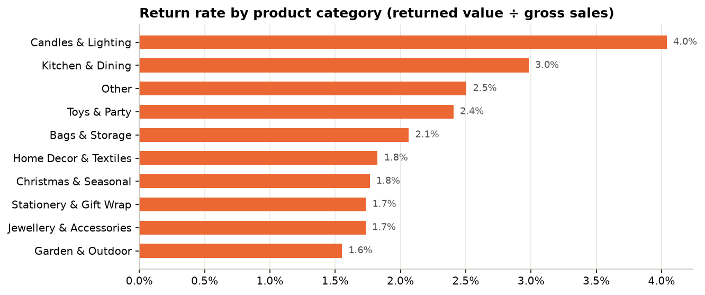
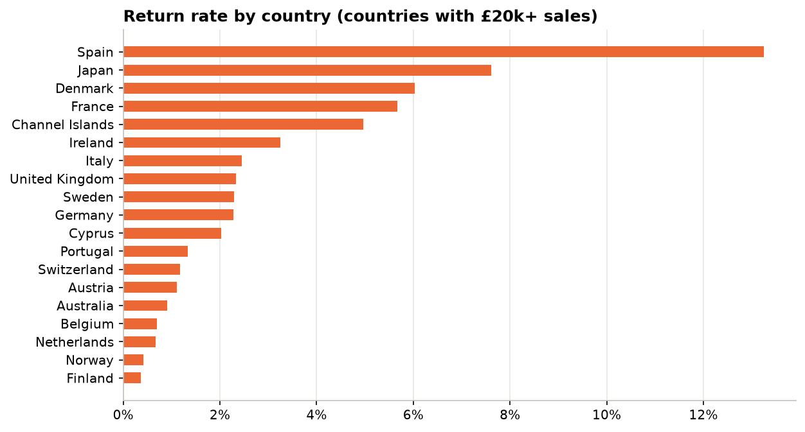
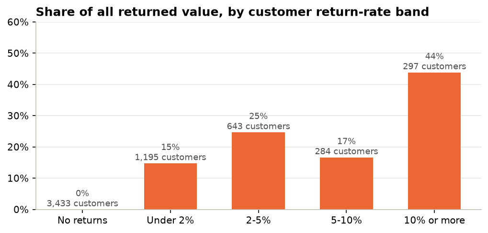
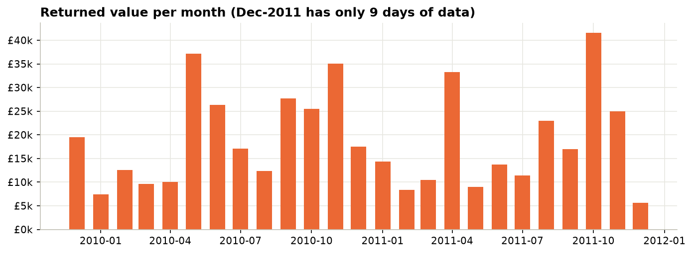
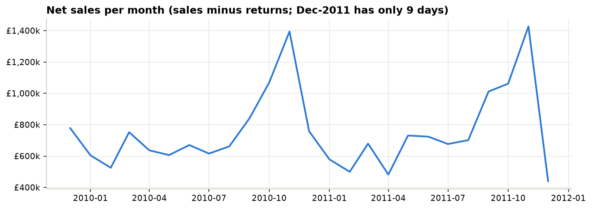

# Why are customers returning orders? Returns & delivery analysis

Analysis of **real** invoice data from a UK online gift retailer (1 million invoice lines, Dec-2009 to Dec-2011).
The main story is **returns (reverse logistics)**: how much comes back, which products, regions and customers drive it,
and what it costs. A smaller second part covers sales and customers.

> **About the data.** This project uses the public **Online Retail II** dataset from the UCI Machine Learning Repository
> (real transactions, CC BY 4.0). Nothing was generated or simulated. It has limits, listed below, and the findings
> describe one retailer in 2009–2011, so the focus is on method (cleaning, SQL, Power BI) as much as on the answers.
>
> Initial build with help from a friend; I reworked the analysis to practise SQL and Power BI.

**Tools:** SQL (MySQL 8) · Power BI (DAX, 4 pages) · Python/pandas for cleaning and charts



---

## Business questions

**Part 1: Returns (main)**
1. What share of sales comes back as returns, and what does that cost?
2. Which product categories have the highest return rate?
3. Do UK, EU and international customers return at different rates? Which countries stand out?
4. Is the return rate going up or down over time?
5. Which products and which customers cause most of the returns?
6. How much do customers pay for delivery, at home and abroad?

**Part 2: Sales & customers (smaller)**
7. How do sales move month to month, and which categories sell most?
8. How many customers come back and buy again?

**What this data can't answer:** payment method (so no cash-on-delivery), discounts (only 177 discount lines in two years)
and delivery times (no dispatch or delivery dates). Credit notes also don't say *why* something came back, or separate
cancellations from returns.

## Headline numbers

| Gross sales | Returned value | Return rate | Credit notes | Customers who returned | Repeat customers |
|---|---|---|---|---|---|
| £19.40m | £470.8k | 2.4% | 7,403 | 41.6% | 72.3% |

## What the data shows

- **About 2.4% of sales value comes back.** That is low, because most buyers are shops ordering stock, not consumers.
- **Candles & Lighting (4.0%) and Kitchen & Dining (3.0%) are returned most.** Both are full of fragile items (glass holders,
  light chains, ceramic cake stands). That may be part of the reason, but the data has no return reasons, so it's a hypothesis to test.
- **International orders come back more than UK orders** (2.9% vs 2.3%). EU customers have the highest regional rate (3.1%).
- **Country rankings hide single customers.** Spain has the highest return rate (13%), but one customer is 95% of Spain's returned value.
- **Returns are concentrated.** 297 customers who return 10%+ of what they buy account for 44% of all returned value,
  and 58% of customers never return anything. That makes it a short list to investigate rather than a company-wide problem.
- **Delivery charges:** only 4% of UK orders carry a postage line, compared with 58% of international orders. Postage is about 4% of goods value abroad and 2% in the UK.
- **Sales** climb from August and peak in November (shops buying Christmas stock). 72% of customers order more than once.

| Return rate by country (£20k+ sales) | Share of returns by customer return-rate band |
|---|---|
|  |  |

| Returned value per month | Net sales per month |
|---|---|
|  |  |

---

## How it was built

```
UCI download ──► 01_data_cleaning.ipynb ──► data/processed/ ──┬──► sql/ (MySQL analysis, 9 files)
 (data/raw)       cleaning log, checks                         ├──► 02_returns_analysis.ipynb (charts)
                                                               └──► powerbi/ (4-page report, 14 DAX measures)
```

| Step | What I did | Where |
|---|---|---|
| 1. Data | Downloaded the real UCI file and saved it as one CSV | `scripts/download_data.py` |
| 2. Cleaning | Standardised product codes, removed duplicates, labelled sales vs returns (credit notes), separated postage lines, removed stock write-offs and two order-entry mistakes, tagged products with a category, mapped countries to regions. Every rule is in `cleaning_log.csv` | `notebooks/01_data_cleaning.ipynb` |
| 3. SQL | Schema, data-quality checks and ~30 analysis queries using JOINs, GROUP BY, CASE WHEN, CTEs, RANK and LAG. Each query has a one-line comment with the business question it answers | `sql/` |
| 4. Charts | Simple pandas/matplotlib charts for this README | `notebooks/02_returns_analysis.ipynb` |
| 5. Power BI | Star schema (1 fact table + 4 lookup tables + a date table), 14 simple DAX measures, 4 pages: Returns Overview, Return Drivers, Sales & Delivery, Customers | `powerbi/` |

### Cleaning summary (raw → clean)

| Step | Rows removed |
|---|---|
| Exact duplicate rows | 34,335 |
| Double entries (same invoice, product, quantity, price) | 4 |
| Non-product lines (postage kept separately; fees, manual adjustments, bad-debt lines removed) | 5,980 |
| Zero-price lines (incl. 3,362 stock write-offs: *damaged*, *lost*, *missing*) | 5,928 |
| Two bulk-order mistakes (80,995 and 74,215 units, reversed within 20 minutes) | 4 |
| **1,067,371 raw rows → 1,021,120 clean product lines** | |

Product categories are **my own keyword grouping** (`data/reference/category_keywords.csv`) because the source has none.
About 4% of sales doesn't match a keyword and is shown as *Other*.

## Repository structure

```
├── data/
│   ├── raw/          downloaded file (not in Git, see data/raw/README.md)
│   ├── processed/    clean tables (rebuilt by notebook 01, not in Git except cleaning_log.csv)
│   └── reference/    country → region lookup, category keywords
├── docs/             data dictionary, KPI definitions, walkthrough, chart images
├── notebooks/        01 cleaning · 02 returns analysis (charts)
├── powerbi/          Returns_Analysis.pbip (+ .SemanticModel / .Report)
├── scripts/          download_data.py, run_sql_tests.py
└── sql/              01 schema … 09 reporting view
```

## How to run it

```bash
pip install -r requirements.txt
```

```bash
python scripts/download_data.py
```

```bash
jupyter nbconvert --to notebook --execute --inplace notebooks/01_data_cleaning.ipynb notebooks/02_returns_analysis.ipynb
```

```bash
python scripts/run_sql_tests.py
```

- **SQL on MySQL:** from the repo root run `mysql --local-infile=1 -u <user> -p < sql/01_create_schema.sql`, then any other file.
  `run_sql_tests.py` runs every query on the clean CSVs with DuckDB, so you can check the SQL without a database server
  (34 queries, 0 failures, and totals match pandas).
- **Power BI:** open `powerbi/Returns_Analysis.pbip` in Power BI Desktop. The `DataFolder` parameter defaults to
  `C:\data\processed\`. Copy the CSVs there, or change it under **Transform data › Edit parameters** (ending with `\`), then
  **Refresh**. Monthly charts leave out December 2011 because the data stops on 9 Dec. See [powerbi/README.md](powerbi/README.md).

More detail: [data dictionary](docs/data_dictionary.md) · [KPI definitions](docs/kpi_definitions.md) ·
[walkthrough: how everything works](docs/walkthrough.md)

## Data source and licence

Chen, D. (2019). *Online Retail II* [Dataset]. UCI Machine Learning Repository. https://doi.org/10.24432/C5CG6D.
Licensed under CC BY 4.0.
